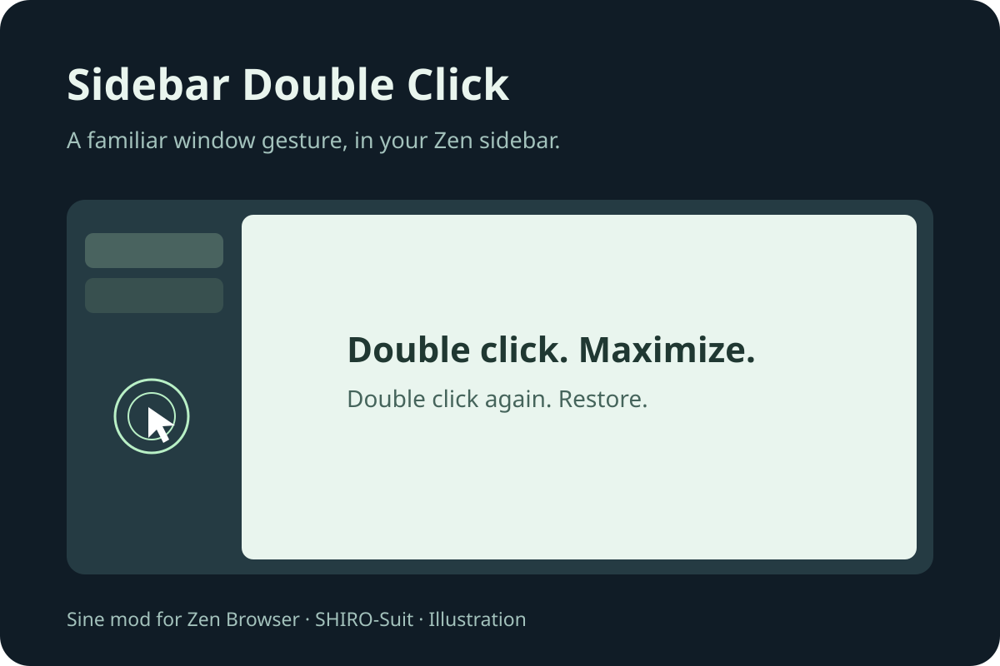

# Sidebar Double Click

A small **Sine mod for Zen Browser**. Double-click unused sidebar space to maximize
the window; double-click again to restore its previous size.



It uses the browser's window APIs and does not change the sidebar layout or its
dragging rules. Tabs, buttons, workspaces, folders, media controls and the address
bar keep their own gestures. F11 fullscreen is left alone.

## Install with Sine

1. Install [Sine](https://github.com/CosmoCreeper/Sine) if necessary.
2. Open Zen Settings → Sine Mods. In Sine's settings, enable JavaScript from
   unofficial sources for this direct-repository install (`sine.allow-unsafe-js`).
3. Add `SHIRO-Suit/zen-sidebar-double-click` in the GitHub repository field.
4. Install, enable the mod, and restart Zen.

The repository must be public before Sine can install it this way. This mod uses
privileged browser JavaScript; its complete implementation is in
[`sidebar-double-click.uc.js`](sidebar-double-click.uc.js). No network requests,
telemetry, dependencies, or page-content access.

## Utilisation (français)

Double-clique sur une zone vide de la barre latérale pour agrandir la fenêtre.
Un second double clic la remet à sa taille précédente. Il s'agit de la
maximisation Windows, pas du plein écran F11. Les onglets et boutons conservent
leur comportement habituel. Le glisser de fenêtre reste géré par Zen.

## Compatibility and validation

Verified on Zen **1.23.4b on Windows** in a disposable profile: the script loads,
and both WebDriver pointer actions and native Windows double clicks on the empty
tab area maximize the window and restore it again. The script was loaded through
a privileged test harness; installation through Sine and compatibility with other
mods still need acceptance testing.

The 18 automated unit tests cover window-state transitions, native double-click
coexistence, excluded events, metadata and cleanup. Remaining real-browser checks
are listed in [TESTING.md](TESTING.md).

The mod deliberately recognizes known sidebar background containers only. If a
theme replaces those containers, its blank area may need explicit support.
macOS and Linux have not been validated. Existing native titlebar double-click
behavior can make this mod redundant on some setups.

## Remove

Remove the mod in Sine, then restart Zen. No preferences or user data are created.

## Development

Requires Node.js 20 or later. No `npm install` is needed.

```sh
npm test
npm run check
```

To unload the running script immediately from the privileged Browser Console:
`window.zenSidebarDoubleClick?.destroy()`.

## Publish

See [PUBLISHING.md](PUBLISHING.md) for GitHub and the Sine marketplace submission.
Zen's built-in CSS-only Mods registry cannot run this JavaScript behavior.

MIT license. Independent community mod; not affiliated with Zen or Sine.
